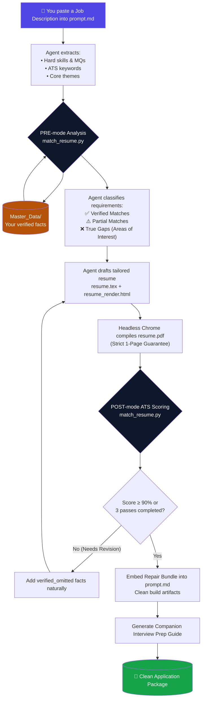
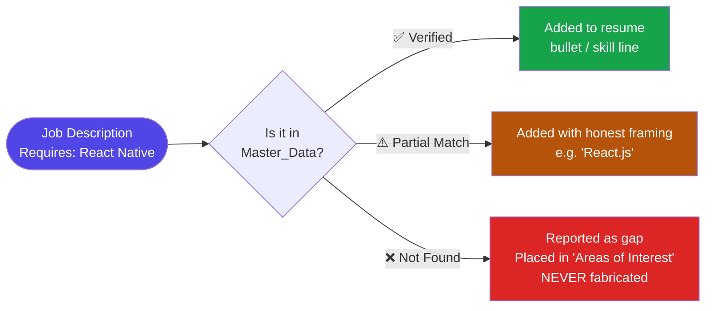

# ⚡ Agentic Resume Engine

[](LICENSE)
[](https://python.org)
[]()
[]()
[]()

An AI-agent-powered automated resume production pipeline that transforms job descriptions into **truthful**, **ATS-optimized**, **1-page PDF resumes** and companion **interview preparation guides** using Headless Chrome and your local AI coding assistant.

> **Zero-Fabrication Policy**: This engine enforces a strict truth boundary. It tailors resumes strictly using verified facts from your personal `Master_Data/` files and will **never** invent skills, employers, or metrics to artificially inflate match scores.

---

## 🌟 Why Agentic Resume Engine?

Traditional AI resume tools frequently hallucinate credentials, invent fake percentages, or produce messy multi-page documents that fail automated Applicant Tracking Systems (ATS).

**Agentic Resume Engine** solves this with an engineering-grade pair programming architecture:

- **Master Data as Ground Truth:** The agent can NEVER add a skill, tool, or metric unless it exists in your verified `Master_Data/`.
- **Guaranteed 1-Page Layout:** Rendered via HTML/CSS and compiled with Headless Chrome (`--print-to-pdf`) with sub-millimeter margin guards.
- **Objective ATS Scoring Loop:** Measures hard-skill keyword density, Minimum Qualifications (MQs), and ATS formatting with up to 3 truthful revision passes.
- **Disaster-Proof Repair Bundles:** Intermediate HTML and scoring state are automatically serialized into `prompt.md` comments before temporary build files are cleaned up.
- **Cross-Platform Compilation:** Built-in auto-detection for Google Chrome, Chromium, and Edge across Windows, macOS, and Linux.
- **Companion Interview Guides:** Automatically generates an 8-module technical systems engineering study guide for every application.

---

## 🏗️ Architecture & How It Works



---

## 🛡️ Truth Engine: What Gets Into Your Resume



---

## 📦 Output: Clean Application Package

Every completed job application produces a pristine, self-contained folder containing:

```
Akamai - Software Engineer/
├── prompt.md                               ← Your original prompt + Repair Bundle in comments
├── job-description.md                      ← Clean copy of the target JD
├── resume.pdf                              ← 1-page tailored ATS resume
├── job-match-report.pdf                    ← Scoring breakdown, keyword analysis, and gaps
└── Akamai_Software_Engineer_Interview_Prep.pdf ← Companion 8-module technical interview guide
```

---

## 🚀 Quick Start (5 Minutes)

### Option 1: AI Agent Setup Prompt (Recommended)
If you are using an AI coding assistant (**Antigravity**, **Cursor**, **Windsurf**, or **VS Code with Claude/Copilot**), simply paste this prompt into your agent chat:

```text
Initialize the Agentic Resume Engine in this workspace: run python setup.py, 
verify Google Chrome availability, and guide me through populating Master_Data/ 
with my verified background information!
```

### Option 2: Manual Terminal Setup

1. **Clone the Repository:**
   ```bash
   git clone https://github.com/CoderShubhamMate/agentic-resume-engine.git
   cd agentic-resume-engine
   ```

2. **Run 1-Click Bootstrap:**
   ```bash
   python setup.py
   ```
   *(This script checks Python ≥ 3.10, auto-detects Google Chrome/Chromium, and installs dependencies from `tools/requirements.txt`)*

3. **Populate Your `Master_Data/`:**
   Edit the markdown files in `Master_Data/` with your real history:
   - `All_Info.md` — Core contact info, professional summary, and verified skills.
   - `Education_and_Skills.md` — Degree history, CGPA/percentages, and usage tiers (`strong`, `summary_only`, `cert_only`).
   - `Projects.md` — Locked project names, verified tech stacks, and publication links.
   - `Timeline.md` — Chronological master timeline across academic degrees and internships.

---

## 📜 The 10-Rule Governance Suite

The engine is governed by 10 immutable operational rules located in `.agents/rules/`:

| Rule | File | Core Mandate |
| :---: | :--- | :--- |
| **00** | `00-meta-and-priority.md` | Meta rules, read-only protected locations, strict priority resolution. |
| **01** | `01-truthfulness.md` | Single source of truth in `Master_Data/`; zero-fabrication contract. |
| **02** | `02-project-naming-and-stacks.md` | Project names and stack lines are strictly locked to match your GitHub. |
| **03** | `03-tailoring-and-writing.md` | JD analysis, ATS keyword surfacing, professional summary framing. |
| **04** | `04-areas-of-interest.md` | Dedicated final section for unverified JD concepts (avoids fabrication). |
| **05** | `05-resume-template.md` | ATS-friendly monochrome left-rail layout template. |
| **06** | `06-build-pipeline.md` | Step-by-step compilation using cross-platform Headless Chrome. |
| **07** | `07-match-and-revision-loop.md` | Objective ATS scoring, pass thresholds, and revision loop termination. |
| **08** | `08-cleanup-and-file-safety.md` | Safe build artifact cleanup and `prompt.md` Repair Bundle archiving. |
| **09** | `09-validation-and-final-response.md` | Pre-flight validation checklist before delivering final files. |
| **10** | `10-security-and-credentials-policy.md` | Credential security policy: zero password or token leaks. |

---

## 💻 Cross-Platform PDF Compilation

The engine includes `tools/compile_pdf.py` which automatically locates Google Chrome or Chromium:

```bash
python tools/compile_pdf.py --html resume_render.html --pdf resume.pdf
```

### Manual Command Equivalents:
- **Windows:**
  ```cmd
  "C:\Program Files\Google\Chrome\Application\chrome.exe" --headless=new --disable-gpu --no-pdf-header-footer --print-to-pdf="resume.pdf" "file:///full/path/to/resume_render.html"
  ```
- **macOS:**
  ```bash
  "/Applications/Google Chrome.app/Contents/MacOS/Google Chrome" --headless=new --disable-gpu --no-pdf-header-footer --print-to-pdf="resume.pdf" "file:///full/path/to/resume_render.html"
  ```
- **Linux:**
  ```bash
  google-chrome --headless=new --disable-gpu --no-pdf-header-footer --print-to-pdf="resume.pdf" "file:///full/path/to/resume_render.html"
  ```

---

## ❓ Frequently Asked Questions (FAQ)

<details>
<summary><strong>Q: What happens if a job requires a skill I do not have?</strong></summary>
The engine will never fabricate it in your Skills, Experience, or Projects sections. If the concept is relevant to the domain, it places it honestly into the <strong>Areas of Interest</strong> section (e.g., <em>"Interested in developing expertise in: Kubernetes, Distributed Systems"</em>). This allows you to surface relevant ATS keywords without being untruthful.
</details>

<details>
<summary><strong>Q: How do I restore build files after cleanup?</strong></summary>
Every completed run embeds a <code>## REPAIR BUNDLE</code> at the bottom of <code>prompt.md</code> containing the full final <code>resume_render.html</code> and <code>job-match.json</code>. You can copy the HTML block directly to restore the editable source code at any time.
</details>

<details>
<summary><strong>Q: How does the ATS Matcher score resumes?</strong></summary>
The score (0–100%) is calculated across weighted components: Hard Skills (40%), Job Keywords (20%), Text Similarity (10%), Job Title Alignment (10%), Experience Tenure (8%), ATS Formatting (7%), and Soft Skills (5%).
</details>

---

## 📄 License

This project is licensed under the [MIT License](LICENSE).
